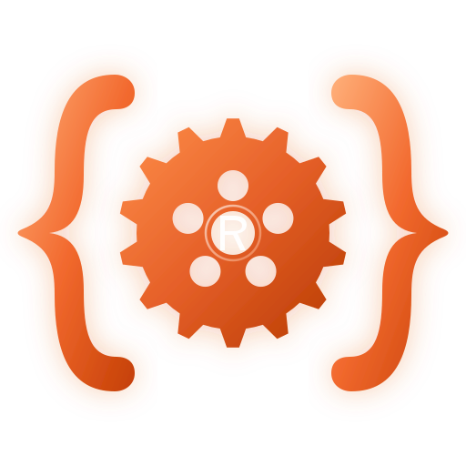

# rost

<p align="center">
  
</p>

<p align="center">
  <strong>Blazing-Fast Zero-Copy Document Parser, Indexer, and Malleable Engine for the <code>.rost</code> Format</strong>
</p>

---

## Overview

The **`.rost`** declarative specification format bridges the gap between human-readable text documents and near-instant zero-copy memory parsing. By pairing SIMD-vectorized token scanners with raw byte-offset arenas, `rost` processes over **70,000 tokens in ~1.3 ms** (~500 MB/s sustained throughput).

`rost` serves as the core language foundation for:
1. **Declarative UI & Stylesheet Engines:** Ultra-fast, decoupled styling for Rust graphical frameworks (GPUI, egui, Iced, Slint, Bevy UI).
2. **Game Engines & Real-Time Configs:** High-frequency balance tuning and level asset reloading with zero frame drops.
3. **Linters & Static Code Analysis:** AST pattern matching schemas and lint rules.

---

## Features

- **⚡ Zero-Copy Architecture:** String slices (`&str`) point directly into the underlying buffer without intermediate heap allocations.
- **🛠️ Malleable Engine:** Supports both zero-allocation querying and in-place document patching for live hot-reloading.
- **🧩 Ecosystem Integration:** Directly powers [`rost-lsp`](https://github.com/rost-rs/rost-lsp) and [`tree-sitter-rost`](https://github.com/rost-rs/tree-sitter-rost).

---

## Quick Start

Add `rost` to your `Cargo.toml`:

```toml
[dependencies]
rost = { git = "https://github.com/rost-rs/rost.git" }
```

### 1. Document Parsing & Querying

```rust
use rost::Template;

let raw = r#"
@theme "cyber-dark"

#button.primary {
    width: 140px,
    height: 44px,
    bg: #1e1e2e,
    state | idle, hover, active |
}
"#;

let template = Template::from_str(raw);
assert_eq!(template.get_directive("theme"), Some("cyber-dark"));

let blocks = template.blocks();
assert_eq!(blocks[0].name, "button.primary");
assert_eq!(blocks[0].get("width"), Some("140px"));
```

### 2. Programmatic Document Building

```rust
use rost::RostBuilder;

let document = RostBuilder::new()
    .directive("theme", "cyberpunk")
    .property("font_size", "14px")
    .enumeration("modes", &["light", "dark"])
    .build();

assert!(document.contains("@theme \"cyberpunk\""));
```

---

## Testing & Benchmarks

Run test suite:

```bash
cargo test
```

---

## License

MIT License. Copyright (c) 2026 The Rost Project Contributors.
